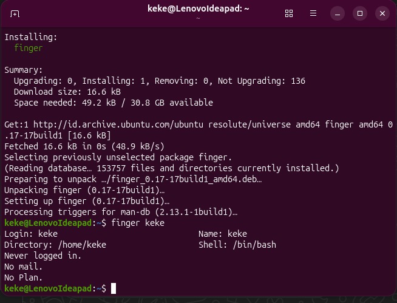
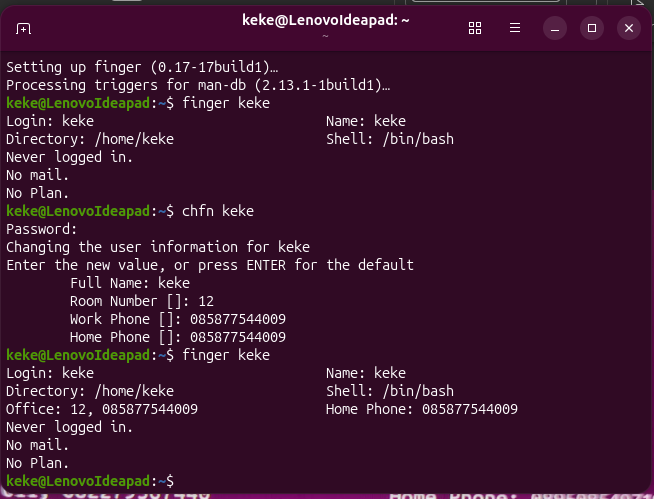
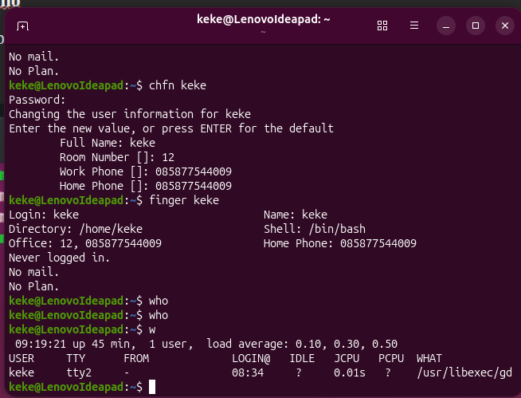
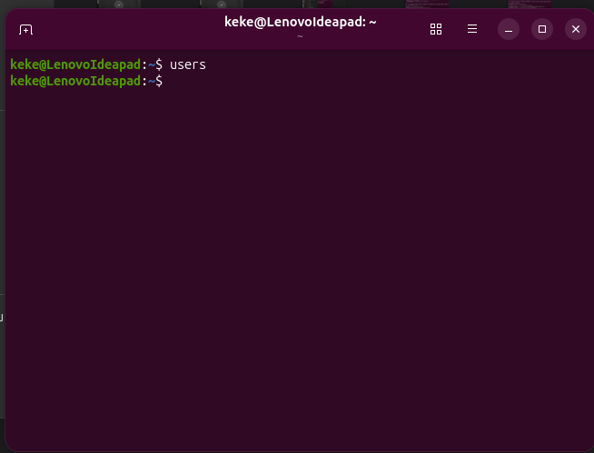
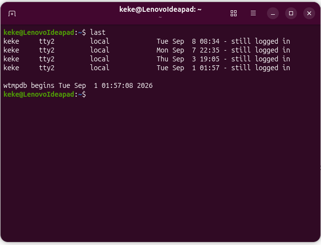
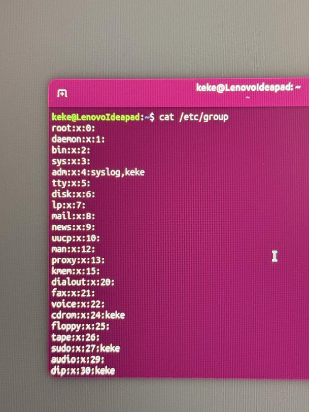
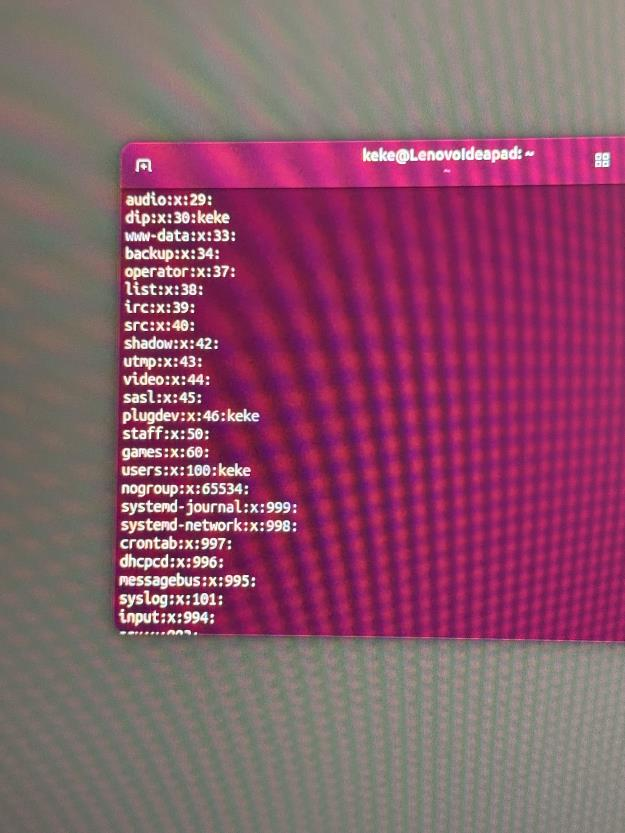
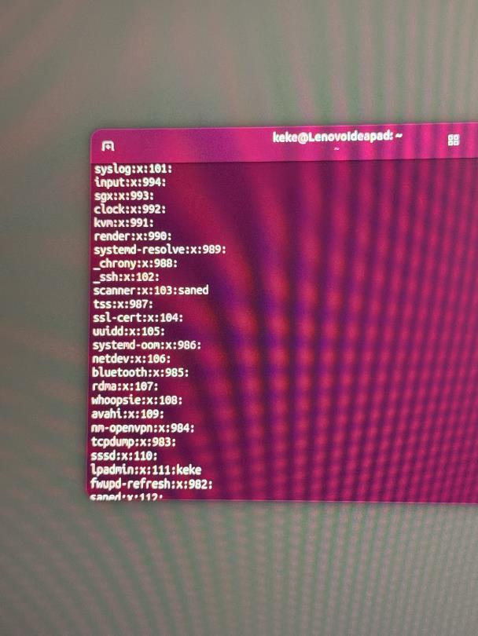
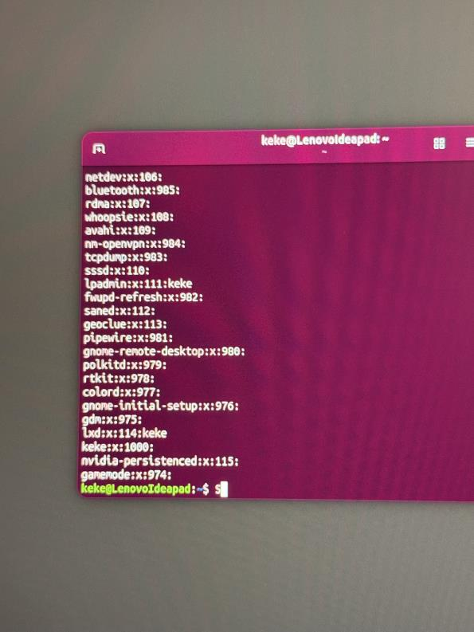
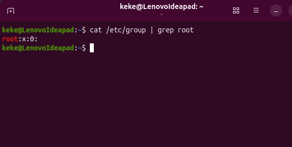

# Tugas 4 Sistem Operasi : mengubah informasi finger di linux

**Nama:** M. Rizky Putra Wijaya  
**NIM:** 09011382530139  
**Kelas:** SKU3A  
**Mata Kuliah:** Sistem Operasi


## 1. Mengubah Informasi Finger pada Komputer

Perintah `finger` digunakan untuk melihat informasi akun pengguna, sedangkan `chfn` digunakan untuk mengubah beberapa informasi akun tersebut.

### Sebelum perubahan

Pada tahap awal, informasi akun pengguna diperiksa menggunakan perintah:

```bash
finger keke
```

Hasil pemeriksaan sebelum perubahan ditampilkan pada gambar berikut.



### Sesudah perubahan

Untuk mengubah informasi akun, jalankan perintah:

```bash
chfn keke
```

Isikan informasi pengguna sesuai petunjuk yang muncul di terminal. Setelah itu, gunakan kembali perintah `finger` untuk memeriksa perubahan:

```bash
finger keke
```

Gambar berikut memperlihatkan informasi akun sesudah diperbarui.



## 2. Melihat Pengguna yang Sedang Aktif

Pemeriksaan informasi pengguna dilakukan menggunakan tiga perintah: `who`, `users`, dan `last`.

### A. Perintah `who`

Perintah `who` digunakan untuk melihat pengguna yang sedang masuk (*login*) ke sistem.

```bash
who
```



### B. Perintah `users`

Perintah `users` digunakan untuk menampilkan nama pengguna yang saat itu tercatat sedang login.

```bash
users
```

Pada hasil tangkapan layar tugas, perintah ini tidak menampilkan nama pengguna.



### C. Perintah `last`

Perintah `last` digunakan untuk menampilkan riwayat login pengguna yang tercatat pada sistem.

```bash
last
```

Hasil pada terminal memperlihatkan beberapa catatan sesi login pengguna.



## 3. Membuka dan Menganalisis File `/etc/group`

File `/etc/group` berisi informasi grup pengguna pada sistem Linux. Pada bagian ini, dilakukan pemeriksaan isi file dan analisis baris `root:x:0`.

### A. Menampilkan isi `/etc/group`

Jalankan perintah berikut pada terminal:

```bash
cat /etc/group
```

Karena keluarannya cukup panjang, dokumentasi dibagi menjadi empat gambar berikut.









### B. Mencari baris grup `root`

Untuk menampilkan baris yang memuat kata `root`, gunakan perintah:

```bash
cat /etc/group | grep root
```



Hasil yang ditunjukkan pada dokumen tugas adalah:

```text
root:x:0:
```

### C. Analisis baris `root:x:0`

Format tiap baris pada `/etc/group` adalah:

```text
nama_group:password:GID:daftar_anggota
```

Penjelasan bagian-bagiannya berdasarkan dokumen tugas:

1. **`root`** — Nama grup, yaitu grup `root` yang berkaitan dengan akun superuser pada sistem Linux.
2. **`x`** — Penanda bahwa informasi kata sandi grup tidak ditulis langsung pada `/etc/group`, melainkan dikelola melalui `/etc/gshadow`.
3. **`0`** — *Group ID* (**GID**), yaitu nomor identitas grup. Nomor `0` digunakan untuk grup `root`.
4. **Bagian kosong setelah GID** — Kolom anggota tambahan grup. Karena kolomnya kosong, tidak ada nama pengguna tambahan yang tercantum pada baris tersebut.

## Kesimpulan

Berdasarkan praktik yang didokumentasikan, perintah `finger` dan `chfn` digunakan untuk melihat dan mengubah informasi pengguna. Perintah `who`, `users`, dan `last` membantu melihat informasi pengguna yang sedang login serta riwayat login. Sementara itu, file `/etc/group` dan perintah `grep` digunakan untuk memeriksa informasi grup, termasuk grup `root` dengan GID `0`.

## Sumber

Dokumen asli: **Tugas 4 Sistem Operasi** — M. Rizky Putra Wijaya, kelas SKU3A, NIM 09011382530139. Seluruh tangkapan layar diambil dari dokumen tersebut.

> **Catatan:** Jika repository GitHub bersifat publik, periksa kembali informasi pribadi yang terlihat dalam tangkapan layar sebelum mengunggahnya.
